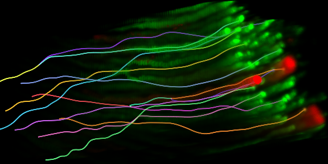
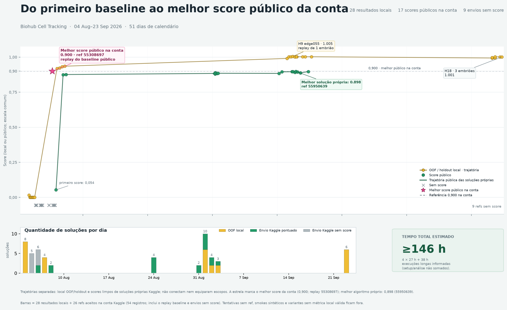

# Kaggle Biohub Cell Tracking During Development

[](https://www.kaggle.com/competitions/biohub-cell-tracking-during-development)

A research laboratory for detecting and tracking cells in 3D time-lapse microscopy: reproducible candidate runs, graph validation, held-out evaluation, ablations, ranking, and explicit Kaggle submission controls.

The submitted inference notebooks and execution instructions are available in [notebooks/](notebooks/README.md).

## Results and scope

Scores verified in the signed-in Kaggle submission details on **19 October 2026**. “Private” means the competition's final hidden-test score, not local validation.

| Pipeline | Public score | Final/private score | Notebook |
|---|---:|---:|---|
| Public-baseline replay — account control, not an original model | **0.90096** | **0.89586** | [Kaggle control](https://www.kaggle.com/code/betitanx/biohub-public-baseline-replay-55308442?scriptVersionId=340673150) |
| H9 v11 — best own public result | **0.89856** | 0.89217 | [Original notebook](notebooks/best-own-h9-v11.ipynb) |
| H9 v13 — best own final/private result among submitted variants | 0.89796 | **0.89259** | [Original notebook](notebooks/best-final-h9-v13.ipynb) |

The control and H9 v11 were selected for final evaluation. H9 v13 was **not selected**; its post-competition score is not the account's official final result. The two own notebooks differ only in `edge_min_threshold`: 0.35 versus 0.30. [Verified scores, source hashes, and provenance](results/kaggle-review.json).

The historical record contains **28 local evaluations and 26 Kaggle submission references**, for **54 evaluation/submission records**, not 54 unique architectures. Kaggle shows 17 successful scored submissions and nine errors. [Historical public results](results/public-results.json) retain the earlier rounded observations; [lab.md](lab.md) describes the experiments and failures.

The runtime estimate is **146 hours**, calculated conservatively from the owner's reported long runs: four runs of about 27 hours plus one of 38 hours. It is an estimate of execution time, not a measurement of hands-on effort or billed GPU time.



The historical figure uses rounded public scores. Local OOF/holdout/replay scores use different scopes and an adjusted metric that can exceed 1.0; they are not directly comparable with Kaggle scores.

## Quick start

Python 3.11 or later is required. The validation checks use Python 3.12.

```bash
python3 -m venv .venv
source .venv/bin/activate
python -m pip install -r requirements-dev.txt
python -m pip install --no-deps -e .
PYTEST_DISABLE_PLUGIN_AUTOLOAD=1 python -m pytest -q
```

Run a small synthetic demonstration without competition data, credentials, GPU use, or network access:

```bash
python -m biohub_lab.cli run --config config/experiments.json \
  --duration-seconds 2 --max-experiments 2 --output-dir runs/demo
python -m biohub_lab.cli rank --runs-dir runs/demo --output-dir outputs/demo
python -m biohub_lab.cli validate --submission tests/fixtures/submission.csv
```

Only the synthetic smoke candidates are enabled in the public default configuration. Real-data candidates and live eligibility are disabled. The synthetic scores exercise the software contract and are not biological results.

Before processing other people's files or launching remote jobs, read [safe usage](docs/SAFE_USAGE.md). Cache directories must be new; CSV conversion does not overwrite by default. Models and external Python inputs must come from trusted, verified sources.

## Run the inference notebooks

Start with [notebooks/README.md](notebooks/README.md). Both included notebooks were downloaded from the actual submitted Version 1 runs. Code cells are unchanged; outputs and execution metadata were removed. Exact configurations are in [best-own-h9-v11.json](config/best-own-h9-v11.json) and [best-final-h9-v13.json](config/best-final-h9-v13.json).

On Kaggle, attach the competition, the [support pack](https://www.kaggle.com/datasets/pilkwang/biohub-tracking-support-pack-50ep-v1), and the [gap-closing input](https://www.kaggle.com/datasets/yoikoarmor/biohub-last-call-postprocess-v1). Use a GPU and disable Internet. Historical preview runs used T4 ×2 and took approximately **16m49s** (v11) and **20m04s** (v13); these are not hidden-test runtime guarantees.

For development, you can also generate a notebook from the local runner:

```bash
python scripts/build_best_own_notebook.py --output outputs/best-own-h9-v11.ipynb
```

This command writes a regenerated notebook without uploading or executing it; it does not replace the original included notebook or prove byte-for-byte equivalence. Models, images, labels, checkpoints, and credentials are not bundled. Dataset licenses and competition rules apply separately. A rerun's score is not guaranteed to match the historical score.

The notebook runner recomputes predictions from mounted competition inputs. The validation layer checks IDs, coverage, finite values, timepoints, edge direction, division degree, and graph topology. Historical scoring failures and their resolution are described in [lab.md](lab.md).

Run the complete lightweight release check with `python scripts/verify_public_release.py`. The recorded [validation report](results/validation.json) covers 362 passing tests, two skipped optional-data tests, notebook syntax, a synthetic two-candidate run, ranking, and topology validation. This check does not run the historical competition workload.

## Repository guide

- `src/biohub_lab/`: control plane, validation, metrics bridges, classical and deep-model adapters, notebook builders, and experimental postprocessing.
- `notebooks/`: the two original, output-free submitted notebooks and execution instructions.
- `tests/`: unit/regression tests and a small synthetic CSV fixture.
- `config/`: sanitized, disabled real-data examples and the recorded best-own parameters.
- `scripts/`: local utilities and optional explicit Kaggle/holdout launchers.
- `external/kaggle-cell-tracking-competition/`: the BSD-licensed source files needed by the baseline wrappers, with license and attribution preserved.
- `results/`: historical score evidence and validation summaries.
- `docs/`: architecture decisions and the project progress image.

The H13 fine-tuning, H15 motion-consensus, H16 DeepCenter, and H17/H18 radius experiments are research code with different validation scopes; their inclusion does not establish public-score improvements. Optional ML integrations load externally supplied Python and model checkpoints; use only reviewed, trusted inputs.

## Provenance and attribution

The organizer's [baseline](https://github.com/royerlab/kaggle-cell-tracking-competition) combines a 3D U-Net, transformer-based linking, and ILP. Its source is BSD-3-Clause. The laboratory adds experiment orchestration, validation gates, ablations, and adapters; original and third-party code remain distinguished in [THIRD_PARTY_NOTICES.md](THIRD_PARTY_NOTICES.md).

The hypothesis-selection workflow was informed by [arXiv:2301.12987v4](https://arxiv.org/pdf/2301.12987v4), operationalized here through held-out generalization, controlled ablations, and complexity checks. Public competition discussions and notebooks were treated as leads to investigate, not as independently verified performance evidence.

Original laboratory contributions: **all rights reserved**, with no general reuse license ([LICENSE](LICENSE)). The bundled organizer baseline retains its BSD-3-Clause license; third-party images, data, and weights have separate terms. See [LICENSE_INFO.md](LICENSE_INFO.md) and [THIRD_PARTY_NOTICES.md](THIRD_PARTY_NOTICES.md).
